<!-- Generated by src/build.py from profile.toml. Edit those, not this file. -->

  

  

  

  
  

  

  

  

Drawn in the colors of my terminal (<a href="https://github.com/ZIPender/zsh-config">zsh-config</a>) and refreshed every day by a GitHub Action.

